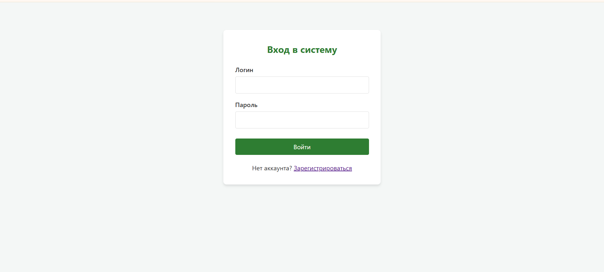
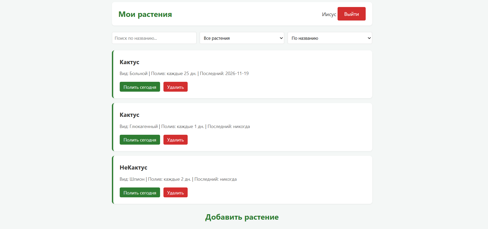
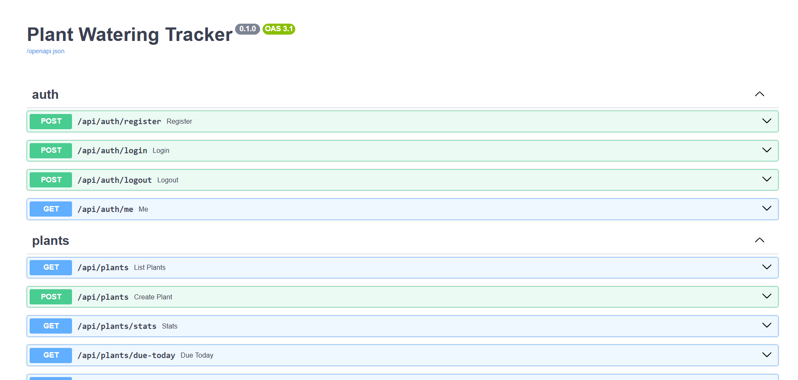

# «Учёт растений», вариант 10.
# Шевелев Иван Ильич, ИСиП-1-9-24

# Команды
активация виртуального окружения

python -m venv venv
venv\Scripts\Activate

Установка зависимостей

pip install -r requirements.txt

Применение миграций базы данных

alembic upgrade head

Запуск сервера

uvicorn app.main:app --reload

# Схема БД

### Таблица `users` (Пользователи)

| Поле | Тип | Описание |
|------|-----|----------|
| `id` | Integer (PK) | Уникальный идентификатор |
| `username` | String(50) | Логин (уникальный, индекс) |
| `password_hash` | String(255) | Хеш пароля (bcrypt) |
| `created_at` | DateTime | Дата регистрации |

### Таблица `plants` (Растения)

| Поле | Тип | Описание |
|------|-----|----------|
| `id` | Integer (PK) | Уникальный идентификатор |
| `name` | String(100) | Название растения (индекс для поиска) |
| `species` | String(100) | Вид (может быть пустым) |
| `watering_interval_days` | Integer | Интервал полива в днях |
| `last_watered_at` | Date | Дата последнего полива |
| `is_favorite` | Boolean | Избранное (флаг) |
| `notes` | String(500) | Заметки |
| `created_at` | DateTime | Дата добавления |
| `owner_id` | Integer (FK) | Ссылка на `users.id` (владелец) |

### Таблица `waterings` (Поливы)

| Поле | Тип | Описание |
|------|-----|----------|
| `id` | Integer (PK) | Уникальный идентификатор |
| `plant_id` | Integer (FK) | Ссылка на `plants.id` |
| `watered_at` | Date | Дата полива |
| `amount_ml` | Integer | Количество воды в мл (опционально) |

**Связи:**
- `User` 1 → ∞ `Plant` (Один пользователь может иметь много растений)
- `Plant` 1 → ∞ `Watering` (Одно растение может иметь много записей о поливе)

### Таблица эндпоинтов

Все эндпоинты, кроме `/api/auth/*`, требуют авторизации (cookie сессии). При отсутствии сессии возвращается **401**.

| Метод | URL | Назначение | Коды ответа |
|-------|-----|------------|-------------|
| **Авторизация** | | | |
| `POST` | `/api/auth/register` | Регистрация | 201, 400, 422 |
| `POST` | `/api/auth/login` | Вход | 200, 401 |
| `POST` | `/api/auth/logout` | Выход | 204 |
| `GET` | `/api/auth/me` | Текущий пользователь | 200, 401 |
| **Растения** | | | |
| `GET` | `/api/plants` | Список (поиск, фильтр, пагинация) | 200, 401 |
| `GET` | `/api/plants/stats` | Статистика (group_by) | 200, 401 |
| `GET` | `/api/plants/due-today` | Кого полить сегодня | 200, 401 |
| `GET` | `/api/plants/{id}` | Одно растение | 200, 401, 404 |
| `POST` | `/api/plants` | Создать | 201, 401, 422 |
| `PATCH` | `/api/plants/{id}` | Изменить | 200, 401, 404, 422 |
| `DELETE` | `/api/plants/{id}` | Удалить | 204, 401, 404 |
| **Поливы** | | | |
| `GET` | `/api/plants/{id}/waterings` | История поливов | 200, 401, 404 |
| `POST` | `/api/plants/{id}/waterings` | Отметить полив | 201, 401, 404, 422 |
| `DELETE` | `/api/waterings/{id}` | Удалить полив | 204, 401, 404 |

## Скриншоты

### Страница входа

### Главная страница со списком растений

### Документация API (Swagger)
